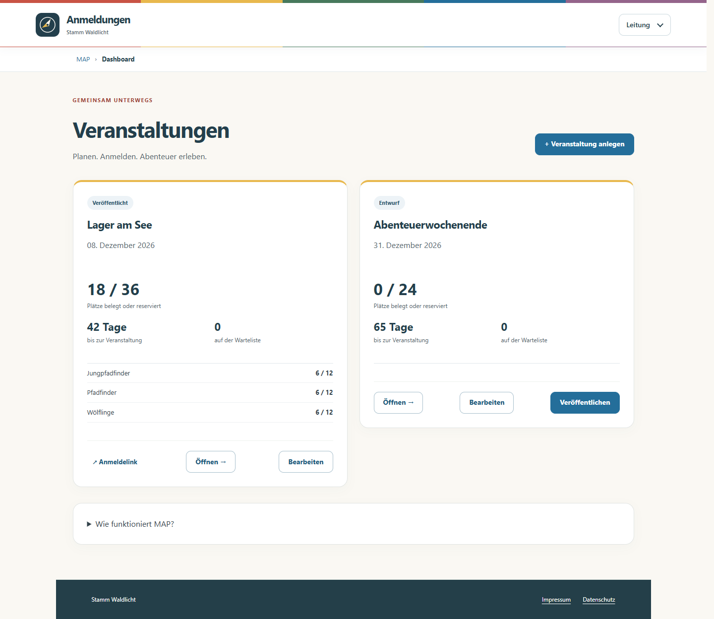
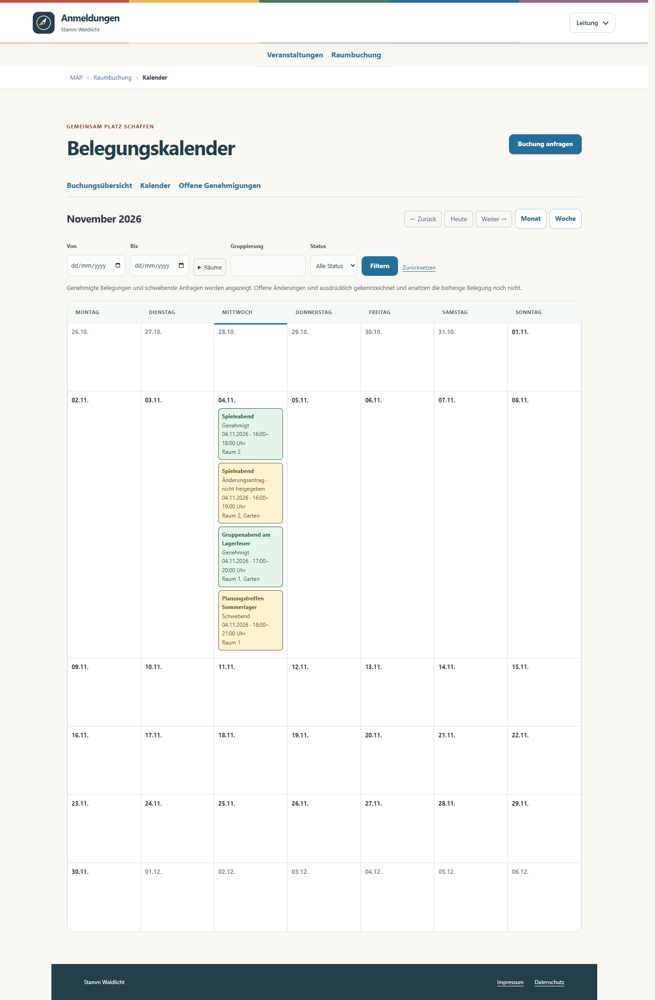
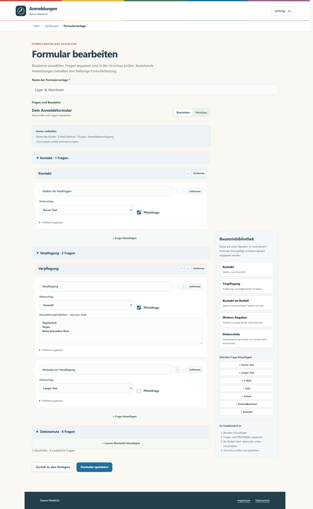
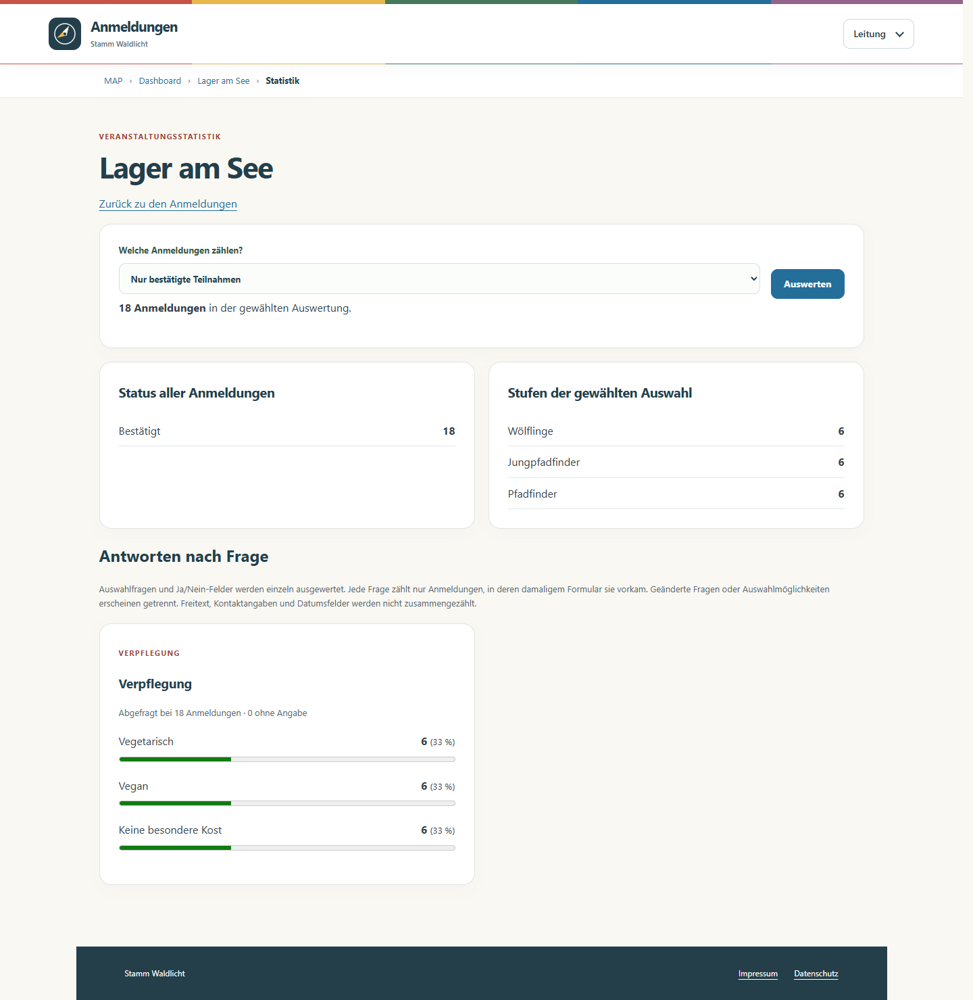
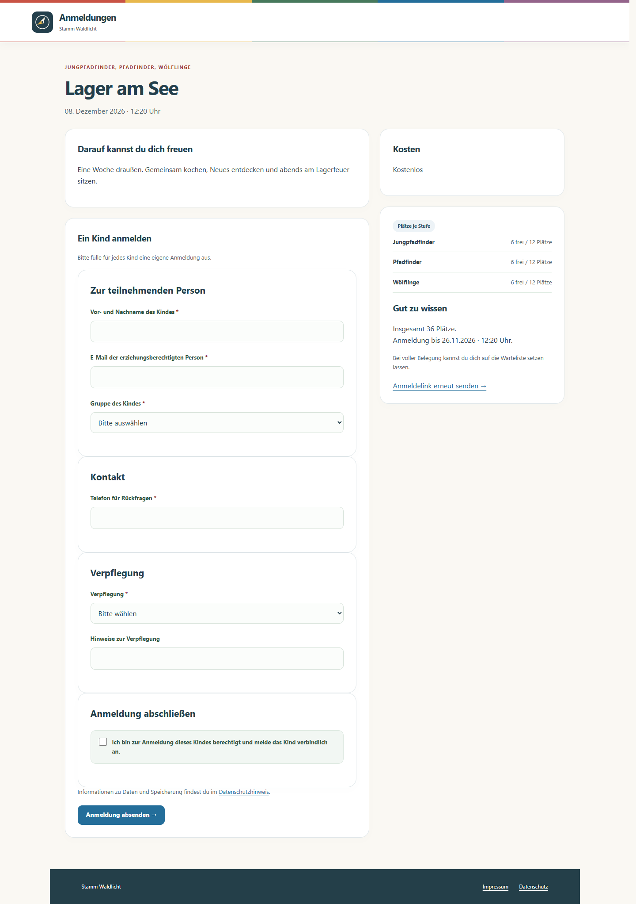

# MAP · Modulare Anmeldeplattform

**Weniger Listen. Mehr Lagerfeuer.**

Veranstaltungen planen, Anmeldungen sammeln und im Leitungsteam den Überblick behalten: MAP ist eine selbst gehostete Anmeldeverwaltung für Pfadfindergruppen und andere Jugendverbände. Eltern benötigen kein Konto – sie erhalten einen direkten Veranstaltungslink und verwalten ihre Anmeldung über persönliche Links.



## Was MAP kann

| Für das Leitungsteam | Für Eltern |
|---|---|
| Veranstaltungen per Assistent anlegen | Ein Kind je Anmeldung, ohne Benutzerkonto |
| Mehrere Stufen, getrennte Kontingente oder gemeinsamer Platzpool | Klare Rückmeldung zu Bestätigung und Warteliste |
| Formularvorlagen aus anpassbaren Bausteinen zusammensetzen | Angaben über einen persönlichen Link ändern |
| Rollen, Stufenrechte und Veranstaltungsfreigaben vergeben | Anmeldung selbst stornieren |
| Warteliste und Nachrücken verwalten | Verständliche Kosten- und Zahlungshinweise |
| Statistiken und Excel-/CSV-Export nutzen | Veranstaltungslink auch als QR-Code öffnen |
| E-Mail-Aufträge prüfen, löschen und erneut versuchen | Kein zusätzliches Elternpasswort merken |

Dazu kommen anpassbare Systemmails, SMTP oder Microsoft 365/Exchange Online über OAuth, Passwort-Reset durch die Administration sowie manuelle Zahlungserinnerungen und Zahlungseingänge. MAP führt **keine Zahlungen** aus und prüft keine Bankumsätze.

## Raumbuchung

Ein separates Modul organisiert frei verwaltbare Räume und Außenbereiche: Anfragen für einzelne oder alle Räume, mehrtägige und ganztägige Termine, Freigaben durch die manuell vergebene Rolle **Vorstand**, sichtbare Überschneidungen und nachvollziehbare Änderungsanträge. Die genehmigte bisherige Belegung bleibt bis zur Freigabe einer Änderung gültig. Monats-/Wochenkalender, Excel-/iCal-Export, E-Mail-Benachrichtigungen und getrennte Raumbuchungs-Mailvorlagen gehören dazu. [Einrichtung und Funktionsumfang](docs/RAUMBUCHUNG_DE.md).

Admins können Räume anlegen und entfernen; genutzte Räume werden zur Erhaltung der Historie archiviert. Eine optionale öffentliche API liefert nur Tagesabdeckung, Status und betroffene Raumnamen. `full` bedeutet lückenlose Belegung aller aktiven Räume über den gesamten Tag; Teilzeit bleibt `partial`. [API und WordPress-Beispiel](docs/RAUMBELEGUNG_API_DE.md).



## Microsoft-Anmeldung und Administration

Microsoft Entra SSO akzeptiert ausschließlich den konfigurierten Tenant. Gruppen-IDs ordnen Leitende automatisch einer oder mehreren Stufen zu; Admin, Manager und Vorstand bleiben manuell vergebene MAP-Rollen. Lokale Anmeldung und technische Admins bleiben als unabhängiger Zugang verfügbar. [Entra einrichten](docs/ENTRA_SSO_DE.md).

Optionale Mailtypen lassen sich direkt in den Vorlagenübersichten schalten. Erforderliche Bestätigungs-, Zugangs- und ausdrücklich angeforderte Sicherheitsmails bleiben geschützt. Benutzerkonten können nach Bestätigung gelöscht werden; betriebliche Buchungen bleiben erhalten. Private Formularvorlagen wechseln dabei den Eigentümer, damit sie nicht versehentlich allgemein sichtbar werden.

Die Oberfläche folgt standardmäßig dem hellen oder dunklen Systemdesign. Im Profilmenü unter „Darstellung“ lässt sich lokal zwischen System, Hell und Dunkel wechseln.

## Ein Blick in die Anwendung

### Formulare, die zur Veranstaltung passen

Abschnitte und Fragen bearbeiten, fertige Bausteine ergänzen und die Vorschau direkt ansehen.



### Anmeldungen und Verpflegung im Überblick

Details bleiben aufklappbar. Klar strukturierte Auswahlfragen lassen sich für die Planung auswerten; freie Texte werden nicht automatisch interpretiert.



### Direkt zur Anmeldung

Eine deutsche Oberfläche, Kostenhinweise und ein Formular, das auch auf schmalen Bildschirmen nutzbar ist.



Alle Screenshots zeigen **echte Anwendungsvorlagen mit ausschließlich erfundenen Beispieldaten**. Es gibt keine öffentlich erreichbare Demo mit gemeinsamen Zugangsdaten. Weitere Ansichten: [Anmeldungsverwaltung](docs/screenshots/anmeldungen.png), [mobile Anmeldung](docs/screenshots/mobil.png).

## Selbst hosten

MAP verwendet Django 5.2, PostgreSQL 16, Gunicorn und Docker Compose. Ein bestehender Reverse Proxy übernimmt HTTPS. Die Produktion enthält kein Mailpit, keine öffentlich freigegebene Datenbank und keine Bind-Mounts für Anwendungscode.

**Start hier:** [Installation auf einem Linux-Server](docs/INSTALLATION.md) · [Konfiguration](docs/KONFIGURATION.md) · [Updates, Backups und Wiederherstellung](docs/BETRIEB.md).

Für einen lokalen Test mit Docker:

```sh
python3 scripts/init-env.py
docker compose build
docker compose --profile tools run --rm init
docker compose --profile tools run --rm init python manage.py createsuperuser
docker compose up -d web worker mailpit
```

Dann: `http://localhost:8000` und Testpostfach `http://localhost:8025`. Die erzeugte `.env` wählt ausdrücklich die Entwicklungsdatei. **Diese Einstellungen nicht unverändert öffentlich bereitstellen.**

## Dein Verband, deine Installation

Stammesname, Betreiberangaben, Datenschutzkontakt, Hosting-/Mailanbieter, Impressum, Absendername, Logo, Favicon und die lokale Fotoverwendung sind konfigurierbar. Es sind keine Konten oder Zugangsdaten eines bestimmten Stamms enthalten. Eigene Bilddateien liegen außerhalb des Repository-Inhalts; die neutrale Kompassgrafik wird mitgeliefert. Logo und QR-Code-Erzeugung verwenden keine externen Dienste.

Veranstaltungen, Stufen, Benutzer, Rechte, Formularvorlagen und SMTP-/Microsoft-Einstellungen werden in der deutschen Verwaltungsoberfläche gepflegt. Technische und rechtliche Betreiberangaben liegen bewusst in der serverseitigen Konfiguration.

## Status und Grenzen

Dies ist ein vorbereiteter **MVP-Releasekandidat**. Den tatsächlichen Prüfumfang und offene Betriebsprüfungen beschreibt [TESTBERICHT.md](docs/TESTBERICHT.md). Insbesondere muss der vollständige PostgreSQL-/Containerlauf im eigenen Deployment bzw. in CI erfolgreich sein; eine Sicherheitsprüfung ist keine Fehlerfreiheitsgarantie.

- Keine automatische Löschfrist: Veranstaltungsdaten bleiben bis zum Löschen der Veranstaltung erhalten. Betreiber müssen Aufbewahrung und Sicherungen selbst organisieren.
- Keine Datei-Uploads und kein Online-Zahlungsdienst.
- Keine automatisierte rechtliche Freigabe der Datenschutzerklärung.
- Keine garantierte Mailzustellung; Versandkonfiguration und Zustellung müssen geprüft werden.
- Standardaufbau für einen Server, keine Hochverfügbarkeit und kein Mandantenbetrieb in einer gemeinsamen Datenbank. Mehrere Organisationen erhalten getrennte Installationen.

## Entwicklung und Sicherheit

[Mitwirken und Tests](CONTRIBUTING.md) · [Sicherheit melden](SECURITY.md) · [Hinweise zu Rechten und Abhängigkeiten](THIRD_PARTY_NOTICES.md).

## Lizenzstatus

**Die Projektlizenz ist noch nicht festgelegt.** Die Veröffentlichung des Quellcodes allein erteilt keine allgemeine Open-Source-Nutzungslizenz. Bis zur Entscheidung wird MAP deshalb nicht als bereits offen lizenziertes Projekt bezeichnet. Abhängigkeiten behalten ihre eigenen Lizenzen. Siehe [LICENSE-NOTICE.md](LICENSE-NOTICE.md).

## Bestehende Produktion aktualisieren

Dieses Release erweitert das Datenbankschema um SSO, Raumbuchung und Mailrichtlinien. Es ist ein vollständiges Release-Update, kein einzelner CSS-Hotfix. Verwende einen geprüften, unveränderlichen Git-Commit und ein separates Release-Verzeichnis; `scripts/apply_release.py --root /opt/map` verweigert die Ausführung direkt aus dem Zielverzeichnis.

Der Installer prüft bekannte Ausgangsstände, isolierte Tests und bestehende Produktivkonfiguration vor der Wartungsunterbrechung. Er sichert Datenbank, bisherige Quellen und Image-IDs, migriert und startet die Dienste mit Gesundheitsprüfung. `.env`, Reverse Proxy und Betreiberdateien bleiben erhalten. Dev-Daten und Demoanmeldungen werden nicht kopiert. [Prod-Release und Rückfallverfahren](docs/PRODUKTIV_UPDATE.md).

Dummy-Veranstaltungen sind ausschließlich bei `MAP_PRODUCTION=0` verfügbar. In Produktion müssen Microsoft-Konfiguration, Gruppenmapping und die neue Rücksprungadresse separat eingerichtet werden; die öffentliche Raum-API ist zunächst ausgeschaltet.
